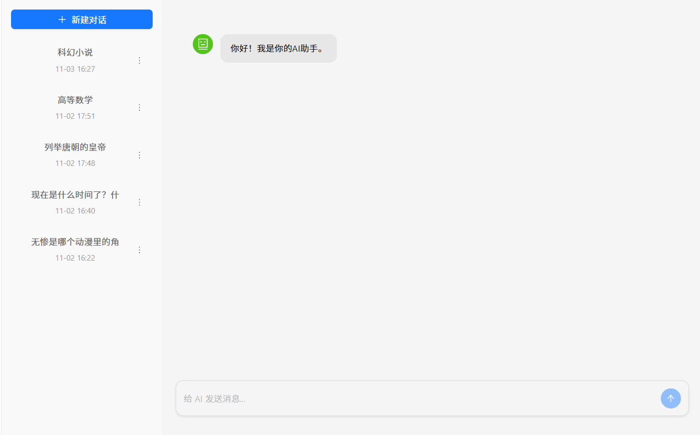

# 🤖 AI Chat 智能对话系统

基于 **React + FastAPI + DeepSeek** 的全栈流式 AI 对话应用。项目采用前后端分离架构，实现了类似 ChatGPT / DeepSeek 官网的沉浸式打字机交互体验。

## ✨ 核心功能

- 🚀 **真流式对话**：基于 SSE (Server-Sent Events) 实现大模型 Token 级流式输出，前端手写 `ReadableStream` 解析，拒绝假打字机。
- 🧠 **多轮上下文记忆**：基于 MySQL 持久化存储，无缝衔接历史对话。
- ⚡ **Redis 上下文缓存**：利用 Redis 缓存近期会话记录，降低数据库读取压力，上下文拼接毫秒级响应。
- 🛡️ **接口防刷限流**：基于 Redis 原子自增与 TTL 机制，限制单用户高频请求，防止 API Token 被盗刷。
- 🛑 **流式中断与止损**：前端基于 `AbortController` 断网，后端精准捕获 `asyncio.CancelledError`，立即掐断大模型请求，避免额外计费。
- 🎨 **Markdown & 公式渲染**：完美解析大模型输出的表格、代码块、LaTeX 数学公式。
- 🛠️ **全局异常拦截**：前后端配合的统一错误处理机制，保证系统高可用，拒绝白屏。

## 🛠️ 技术栈

- **前端**：React 18, TypeScript, Vite, Ant Design & Ant Design X, React-Markdown, Axios
- **后端**：Python 3.11, FastAPI, SQLAlchemy 2.0 (异步), AsyncOpenAI, Redis
- **数据库**：MySQL 8.0.46, Redis 7.4.12

## 📁 项目结构

```text
AI-Chat/
├── Back_end/                 # 后端代码 (FastAPI)
│   ├── config/               # 配置文件 (DB, Redis, LLM API)
│   ├── crud/                 # 数据库操作层
│   ├── dependencies/         # 依赖注入 (Redis限流)
│   ├── models/               # SQLAlchemy 表模型
│   ├── prompts/              # System Prompt 管理
│   ├── routers/              # 路由层
│   ├── schemas/              # Pydantic 数据校验
│   ├── services/             # 核心业务逻辑 (大模型流式调用)
│   └── main.py               # 程序入口
└── Front_end/                # 前端代码 (React)
    ├── src/
    │   ├── api/              # Axios 统一封装与接口定义
    │   ├── components/       # UI 组件 (侧边栏, 聊天区)
    │   ├── types/            # TS 类型定义
    │   └── App.tsx           # 状态中心与页面入口
```

## 📸 界面预览



## 🚀 快速开始

### 方式一：Docker 一键部署（推荐）

如果你安装了 Docker Desktop，只需两步即可拉起完整的前后端及数据库环境。

**1. 克隆项目并进入目录**
```bash
git clone https://github.com/Dongguayt/AI-Chat.git
cd AI-Chat
```

**2. 配置环境变量**
在项目根目录新建 `.env` 文件，填入你的大模型 API Key：
```env
DEEPSEEK_API_KEY=sk-xxxxxxxxxxxxxxxxxxx
```

**3. 启动容器**
在项目根目录执行：
```bash
docker compose up -d --build
```
等待服务启动完成后，访问 http://localhost 即可体验。

### 方式二：本地开发运行

### 1. 克隆项目
```bash
git clone https://github.com/Dongguayt/AI-Chat.git
cd AI-Chat
```
### 2. 数据库与中间件准备
- **启动本地 MySQL 和 Redis。**
- **在 MySQL 中创建数据库 aichat_db，并执行 Back_end/database/database.sql 导入表结构。**

### 3. 后端启动
```bash
cd Back_end
python -m venv .venv
# Windows 激活虚拟环境：
.venv\Scripts\activate
# Mac/Linux 激活虚拟环境：
# source .venv/bin/activate

pip install -r requirement.txt

# 配置环境变量
# 在 Back_end 目录下新建 .env 文件，填入你的密钥：
# DEEPSEEK_API_KEY=sk-xxxxxxxxxxxxxxxxxxx

python main.py
```

### 4. 前端启动
```bash
cd Front_end
npm install
npm run dev
```

**浏览器访问 http://localhost:5173 即可体验。**
